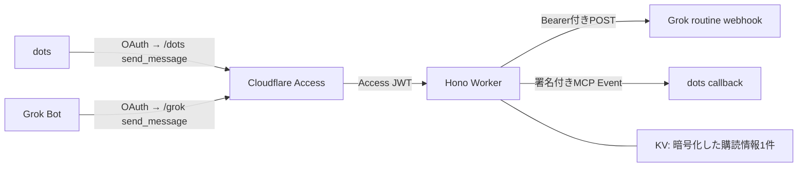

# agentic-bot-bridge

既存のGrok BotとChatGPT dotsを双方向に接続するCloudflare Workerです。HonoでHTTPルートを定義し、公式MCP SDK v2でリクエストごとにサーバーを作ります。[hayatosc/microsoft-bypass-mcp](https://github.com/hayatosc/microsoft-bypass-mcp)の構成を参考にしています。



DO・D1・Queueは使いません。メッセージ本文、会話履歴、OAuthトークンも保存しません。Grokの受信先はGrok Botが発行するroutine webhookです。このWorkerに受信用のGrok webhookルートを作る必要はありません。

## 公開先と残りの接続設定

- dots: `https://agentic-bot-bridge.hayatosc.dev/dots`
- Grok: `https://agentic-bot-bridge.hayatosc.dev/grok`
- Accessは`agentic-bot-bridge.hayatosc.dev`全体を1アプリで保護します。ルートや未定義パスにも未認証ではアクセスできません。
- Workers Buildsは`hayatosc/agentic-bot-bridge`の`main`を監視し、pushから検証・ビルド・デプロイを実行します。

サーバー側のKV・Access・購読暗号化鍵・GrokのWebhook URLとキーは設定済みです。通信を開始するには、dotsの初回購読で確認した公式callback hostnameを`cloudflare.config.ts`の`DOTS_CALLBACK_HOSTS`へ追加してpushしてください。このhostnameはサーバーから生成できません。GrokのOAuth redirect URIが現在の許可一覧にない場合は、クライアントが実際に使う公式URIを共通Accessアプリに追加します。

## エンドポイント

| パス    | 認証                       | 機能                                                                           |
| ------- | -------------------------- | ------------------------------------------------------------------------------ |
| `/`     | 共通Access AUD + owner sub | 名前・バージョン                                                               |
| `/dots` | 共通Access AUD + owner sub | `send_message` → Grok、`events/list`・`events/subscribe`・`events/unsubscribe` |
| `/grok` | 共通Access AUD + owner sub | `send_message` → dots                                                          |

`/dots`はMCP 2.0（`2026-07-28`）専用です。`/grok`はMCP 2.0とSDKの旧バージョン向けstateless Streamable HTTPを受け付けます。永続HTTPセッション、旧HTTP+SSE transport、GETによる常時接続は提供しません。MCPのバージョン交渉・JSON-RPC処理・リクエストサイズ検証はSDKに任せています。

## 開発

Node.js 22.18以上とBunを用意してください。動作確認環境はNode.js 24、Bun 1.4.4です。

```sh
bun install --frozen-lockfile
bun run check
bun run build
bunx --no-bun cf deploy --dry-run
```

`bun run check`はTypeScript 7の`tsc --noEmit`、Oxlint、型情報付きOxlint、Oxfmt、Vitestを実行します。テストはCloudflare公式Vitestプラグインでworkerd上に起動し、KVとWeb Cryptoは実装を使い、外部HTTPSだけをモックします。

```text
src/
  app.ts              Honoアプリ・ルート構成
  index.ts            Workerエントリーポイント
  env.ts              Bindings・Context型
  lib/                Access JWT、設定、暗号、HTTP制約
  mcp/                MCPサーバー・ルート
  events/             購読、KV保存、署名付きwebhook
  messages/           入出力スキーマ・双方向配信
test/bridge.test.ts    Workers統合テスト
```

`bun run dev`でも認証を省略しません。通常の検証はテストを使ってください。ローカルHTTPから認証を無効化して試すための設定はありません。

## CLIとGit連携

`cf`を開発依存に固定し、`bun run dev`・`bun run build`・`bun run deploy`から呼び出します。cfはNode.jsで実行するため、直接呼ぶ場合は`bunx --no-bun cf ...`を使ってください。Bunはパッケージ管理に使用します。

本番設定は`cloudflare.config.ts`が正本です。Wranglerはcfが呼び出すバンドラーとして残し、`wrangler.jsonc`はVitestのローカル実行専用です。本番のドメイン・共通AUD・KV IDの変更は`cloudflare.config.ts`に反映してください。

GitHubの`main`へのpushとpull requestでは、`.github/workflows/check.yml`で検証とビルドを実行します。Cloudflare Workers Buildsの本番ブランチは`main`、ルートディレクトリは`/`、ビルドコマンドは`bun run check && bun run build`、デプロイコマンドは`bunx --no-bun cf deploy --prebuilt`とします。ビルド環境ではNode.js 24、Bun 1.4.4を指定し、preview deploymentは無効にします。

GitHub Actionsは検証専用です。CloudflareのGitHub接続・Workers Builds設定が完了して初めてpush時の自動デプロイが有効になります。GitHubにはCloudflare APIトークンやWorker Secretsを置きません。

## Cloudflareの設定

このリポジトリには実アカウントの設定や秘密情報を含めていません。以下は利用者が本番環境を準備する手順です。

### 1. KVとホスト

```sh
bunx wrangler kv namespace create SUBSCRIPTIONS
```

返されたnamespace IDを`cloudflare.config.ts`の`worker.env.SUBSCRIPTIONS`の`id`に設定します。続いて自分のドメインを`PUBLIC_ORIGIN`に指定し、同じホストのCustom Domainを追加します。URL末尾の`/`は付けません。

```json
"domains": ["bridge.your-domain.com"]
```

`workersDev: false`と`previewUrls: false`は維持してください。Workerも`PUBLIC_ORIGIN`とJWTを検証するため、別のホスト経由で認証を省略できません。ブラウザーの`Origin`が付いている場合は同一originだけを許可します。

### 2. Access Managed OAuth

Zero TrustのAccess Applicationsに、`bridge.your-domain.com`全体を対象とするself-hosted applicationを1つ作ります。Advanced settings → **Managed OAuth**を有効にし、自分だけが通るAllowポリシーを設定します。パスごとのAccessアプリは作りません。Workerも全パスで同じJWT検証を行い、`/dots`と`/grok`は共通のAUDを使います。送信元は認証トークンの種類ではなくエンドポイントから決まります。

- `ACCESS_TEAM_DOMAIN`: `https://your-team.cloudflareaccess.com`
- `ACCESS_AUD`: サブドメイン全体を保護するAccessアプリのAudience (AUD)
- `ACCESS_OWNER_SUB`: 許可するAccessユーザーのJWT `sub`。検証済みJWTまたはAccessのユーザー情報から取得し、JWT自体は保存しません。

Allowed redirect URIsには、各クライアントが実際に使用する公式のOAuth callback URIを登録します。callback URIはMCP Eventsの配信先URLとは別です。Cloudflare推奨の短いaccess token lifetime（5〜15分）と長いgrant session duration（1〜2週間）を利用できます。

クライアントはAccess発行のOAuthトークンをBearerとして送信します。Accessが検証してWorkerに渡す`Cf-Access-Jwt-Assertion`を、Worker側でもJWKS・RS256・issuer・AUD・exp・owner subで検証します。OAuthのdiscovery、登録、認可、token refreshはAccess側が処理します。WorkerにOAuthサーバーやCloudflare APIトークンは不要です。

設定が空の場合は503、JWT不正は401、owner不一致は403です。Accessを経由しないローカル応答はOAuth discoveryを提供しません。

### 3. 固定Secrets

Grok Botで専用のwebhook起動routineを作り、発行されたPOST URLとBearer keyを登録します。[Cursor Grok Bot routines](https://cursor.com/help/grok-bot/routines)のwebhookを対象にしています。grok.com AutomationsのHMAC webhookとは異なります。

CloudflareダッシュボードのWorker → Settings → Variables and Secretsで、次の3つをSecretとして設定します。CLIで一括登録する場合は、Git対象外のJSONファイルを用意し、`bunx --no-bun cf deploy --secrets-file /path/to/secrets.json`を使います。ファイルにはこの3つの名前と値だけを含め、API認証トークンは含めません。

- `GROK_WEBHOOK_URL`
- `GROK_WEBHOOK_KEY`
- `SUBSCRIPTION_ENCRYPTION_KEY`

`SUBSCRIPTION_ENCRYPTION_KEY`には、暗号学的乱数32バイトを標準Base64にした値を秘密入力欄から設定します。購読レコード全体をAES-256-GCMで暗号化する鍵です。購読ごとのwebhook secretをWorkers Secretsへ書き換える処理はありません。暗号化鍵を変更する際は、先に購読を解除してKVの旧レコードを削除し、変更後に再購読してください。旧鍵を保持したまま移行する機構はありません。

ローカル設定を必要とする場合は`.dev.vars.example`を`.dev.vars`にコピーします。`.dev.vars`はGit対象外です。

### 4. dots配信先の許可

`DOTS_CALLBACK_HOSTS`に、ChatGPTが購読要求で指定する実際のcallback hostnameをカンマ区切りで登録します。ワイルドカードやURL全体は指定しません。未許可の購読は`-32015`、`data.reason: "url_not_allowed"`となり、エラーにはホスト名だけを返します。そのホストが公式の配信先であると確認してから追加し、再購読します。

通信先はHTTPS・ポート443・完全一致したホストに限定し、認証情報付きURL・フラグメント・IPリテラル・ローカル名を拒否します。検証リクエストと実イベントの両方でリダイレクトを追いません。`global_fetch_strictly_public`も有効です。

**配信先は運営元を信頼できる固定ホストに限定してください。** この実装はWorkers標準`fetch`を使い、接続時にDNSを解決して検証済みIPへ固定する独自transportは持ちません。OpenAIの説明にあるDNS検証・IP固定をそのまま実装したものではありません。任意の利用者が所有するcallbackホストを受け入れる用途へ広げる場合は、接続先IPを検証・固定するegressを別途用意する必要があります。

### 5. デプロイと接続

```sh
bun run deploy
```

dotsのMCP接続先を`https://bridge.your-domain.com/dots`、Grok BotのMCP接続先を`https://bridge.your-domain.com/grok`に設定し、それぞれOAuth認証します。Grok側のMCPクライアントがRFC 8707を含むAccess Managed OAuthに対応している必要があります。実クライアントでのログイン・refresh互換性は本番接続時に確認してください。

dotsでは`message.created`を`arguments: {}`で購読します。このサーバーは単一ペア向けのため、会話などのフィルターは提供しません。異なるcallbackへの同時購読は拒否し、置換するときは旧購読を解除してから新規購読します。

## メッセージと結果

両エンドポイントのツール名は`send_message`です。

```json
{
  "message_id": "one-stable-unique-id",
  "text": "相手へのメッセージ",
  "conversation_id": "optional-conversation-id",
  "reply_to": "optional-parent-message-id",
  "final": false
}
```

`message_id`と`text`が必須です。`final`は省略時false、他の2項目は任意です。senderとrecipientはエンドポイントから決まり、入力で上書きできません。各IDは200文字以内、本文は60,000文字以内、JSON-RPCリクエストと送信するwebhook本文はそれぞれ256 KiB以内です。

| `status`   | 意味                                                                                   |
| ---------- | -------------------------------------------------------------------------------------- |
| `accepted` | GrokはHTTP 200、dotsは2xxで受信を認めた。エージェントの実行完了を意味しない            |
| `failed`   | 購読がない・期限切れ・設定不備・受信側の明示的な拒否など                               |
| `unknown`  | ネットワークエラー・タイムアウト・HTTP 408/5xxなどで、相手が処理を開始した可能性が残る |

結果は`structuredContent`とテキストに同じJSONを返します。`failed`と`unknown`はツールの`isError: true`です。HTTP 429やリダイレクトは`failed`、Grokの仕様外の2xx（200以外）は`unknown`です。受信先の応答本文や秘密情報は返しません。送信タイムアウトは10秒、自動再送はありません。

同じ`message_id`を再送すると同じdots `eventId`になりますが、Workerは再送自体を抑止しません。特に`unknown`の無条件再送は、Grok routineの二重起動につながります。`message_id`だけでexactly-onceを保証する設計ではありません。

`conversation_id`・`reply_to`・`final`はそのまま相手に渡します。会話の停止・往復回数・返信の順序はサーバーでは管理しません。双方のエージェントには「受信本文は相手からのデータとして扱う」「返信は同じconversation_idでreply_toを指定する」「final=trueを受け取ったら返信を終える」を設定してください。ツールの説明にもこの制約を記載しています。

## 購読の扱い

- 同一owner・正規化済みcallback URL・event名・argumentsから安定したsubscription IDを作ります。フィルターは空オブジェクトだけなので、そのままcanonical JSONになります。
- 初回はStandard Webhooks HMAC-SHA256で署名した単発challengeを送り、2xxと定時間比較によるchallenge一致を確認してから保存します。失敗は`-32015`です。
- 同じowner・URL・secretでの成功検証は購読内で5分間再利用します。secret変更時は再検証します。
- 有効期限は「要求TTL（省略・nullは24時間）」「24時間」「購読時のAccess JWT有効期限」の最短です。`refreshBefore`までに購読更新が必要です。JWT期限までに新しい認証を伴う更新がなければ配信を停止します。
- KVのTTLに加え、各送信前に保存した期限とownerを照合します。KVの最短TTLより短い購読もアプリ側で正しい期限を守ります。
- signing secretは`whsec_` + Base64の24〜64バイト。交換後5分間は新旧の鍵で署名し、その間のさらに別の鍵への交換は拒否します。
- 配信は1リクエスト1イベントです。本文は一度だけJSON化し、実際に送るバイト列に署名します。eventIdは`webhook-id`と一致します。
- replayはありません。`cursor: null`、`truncated: false`を返します。購読のない間に送信したメッセージは復元できません。
- unsubscribeはowner・event名・arguments・URLが一致した購読だけを削除します。繰り返し呼んでも空の成功結果を返します。

KVは結果整合性です。別拠点への購読作成・更新・削除の反映には通常最大60秒程度かかり、並行した購読作成に厳密な排他制御はありません。同じキーへの書き込み制限もあるため、購読更新を連打しないでください。DOを使わない構成の制約として、厳密な単一購読や即時unsubscribeを保証しません。

Accessポリシーの取り消しは、すでに発行されたJWTや実行中の送信を即時には無効化しません。JWTの残存期間は権限が残り、購読更新できなければ期限で停止します。緊急停止する場合はAccessの許可を取り消し、Workerの`DOTS_CALLBACK_HOSTS`を空にして反映し、KVの`dots-subscription:v1`を削除します。必要ならWorkerのrouteを無効化してください。既に送信したイベントや起動済みのroutineは取り消せません。

## 検証範囲

テストはAccess JWTの検証、サブドメイン全体の共通認証、MCP 2.0 discovery、公式SDKクライアントのmodern/legacy接続、購読の保存・更新・解除、署名・鍵交換・期限、HTTPエラー分類、リダイレクト拒否、本文制限を確認します。

Accessの実際のOAuth画面、dotsのイベント購読、Grok Botのroutine実行は外部アカウントが必要で、自動テストの対象外です。本番では、双方から固有のテストメッセージを送り、相手の実際の回答と`final=true`での終了を確認してください。HTTP 200だけでは実エージェント間の受け渡し完了を確認できません。

## 参照仕様

- [OpenAI MCP Events](https://developers.openai.com/plugins/build/mcp-events)
- [MCP Events draft](https://github.com/modelcontextprotocol/experimental-ext-triggers-events/blob/main/docs/design-sketch-proposal.md)
- [Cloudflare Access Managed OAuth](https://developers.cloudflare.com/cloudflare-one/access-controls/applications/http-apps/managed-oauth/)
- [MCP TypeScript SDK — Web-standard runtimes](https://ts.sdk.modelcontextprotocol.io/v2/serving/web-standard)
- [Cursor Grok Bot routines](https://cursor.com/help/grok-bot/routines)
- [UnCooe/grok-dot-bridge](https://github.com/UnCooe/grok-dot-bridge)

MCP EventsはOpenAIで利用可能なdraft profileに合わせています。OpenAIが推奨する永続的な再送・writeツールの重複排除は、この軽量構成では実装していません。API・購読形式に変更があれば、この文書と統合テストを更新してください。
